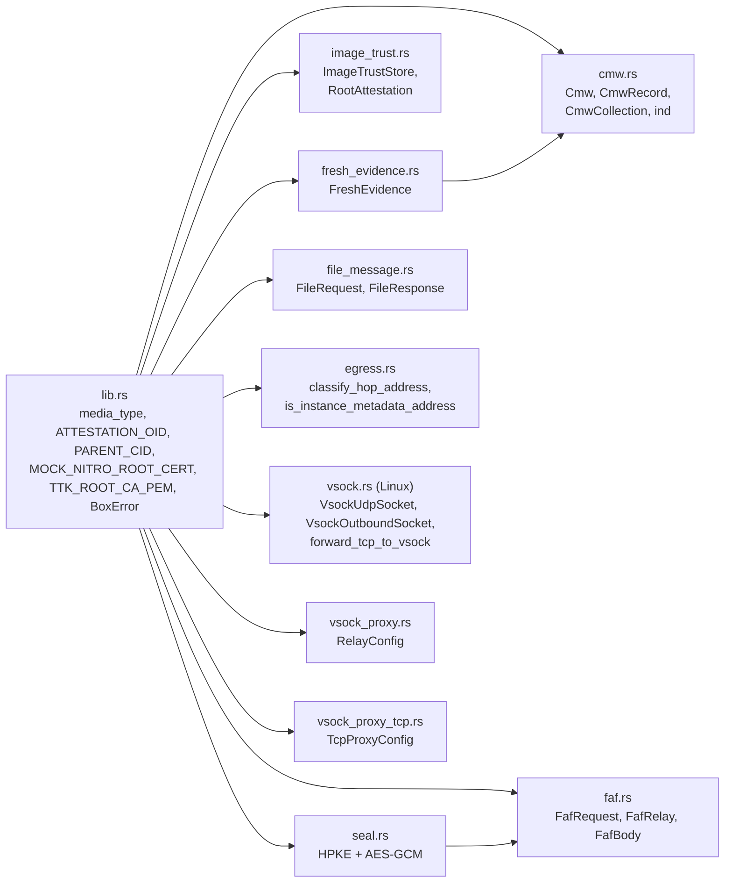

# `ttk-core` Architecture

Crate reference for `crates/core`. For the system-level picture (attestation, onion routing, vsock, deployment), see the [workspace architecture](ARCHITECTURE.md).

Other crates: [`ttk-ra-server`](ra-server.md) · [`ttk-ra-client`](ra-client.md) · [`ttk-relay`](relay.md) · [`ttk-root`](root.md) · [`ttk-storage`](storage.md) · [`ttk-executables`](executables.md)

> **Role:** what the attested server and its client share, so `ttk-ra-client` never depends on `ttk-ra-server`: the CMW evidence wrapper, the RA-TLS constants and the TTK root CA, the fresh-evidence format, the image-trust format, the `/faf` format and its onion sealing, the file service messages, the egress policy, the vsock transport and the configuration of the parent-side proxies. Library only (the proxy binaries live in [`ttk-executables`](executables.md)). No features, and no attestation or verification logic.

## 1. Modules

| File | Responsibility |
|---|---|
| `crates/core/src/lib.rs` | CMW media types (`media_type`), `ATTESTATION_OID`, `PARENT_CID`, `MOCK_NITRO_ROOT_CERT`, `TTK_ROOT_CA_PEM`, `BoxError`; re-exports `Cmw`, `CmwRecord`, `CmwCollection`, `CmwType`, `FreshEvidence`, `ImageTrustStore` |
| `crates/core/src/cmw.rs` | RATS Conceptual Message Wrapper (`draft-ietf-rats-msg-wrap`), CBOR only |
| `crates/core/src/fresh_evidence.rs` | The `POST /evidence` response: fresh Evidence plus the presented RA-TLS certificate |
| `crates/core/src/image_trust.rs` | `ImageTrustStore` trait, `parse_image_allowlist`, the `/root-attestation` wire format |
| `crates/core/src/faf.rs` | The `POST /faf` JSON request format |
| `crates/core/src/seal.rs` | Onion encryption to the nodes' RA-TLS keys (RFC 9180 HPKE) and the sealed terminal reply |
| `crates/core/src/file_message.rs` | The file service's CBOR messages and replies |
| `crates/core/src/egress.rs` | Egress policy for peer-chosen destinations, and the instance metadata exception |
| `crates/core/src/vsock.rs` | quinn `AsyncUdpSocket`s over vsock, their framing helpers, and TCP-over-vsock forwarding (Linux) |
| `crates/core/src/vsock_proxy.rs` | `vsock-proxy` usage text, defaults and argument parsing (platform independent, so `tests/` can reach it) |
| `crates/core/src/vsock_proxy_tcp.rs` | `vsock-proxy-tcp` usage text, defaults and argument parsing |
| `crates/core/src/mock_nitro_root.der` | Mock root CA certificate (its key lives in `ttk-ra-server`) |
| `crates/core/src/TTK_Root_CA.pem` | The TTK root CA: the only root a CA-issued RA-TLS certificate may chain to |

## 2. Public API

**Crate root**

| Item | Kind | Description |
|---|---|---|
| `media_type::{AWS_NITRO, TDX, SGX}` | consts | Record types for Nitro documents and DCAP quotes (`application/vnd.ttk.*`) |
| `media_type::{SEV_SNP_COLLECTION, SEV_SNP_REPORT, PKIX_CERT}` | consts | SEV-SNP collection type and its `report` / `vcek` member types |
| `media_type::{SEV_SNP_REPORT_LABEL, SEV_SNP_VCEK_LABEL}` | consts | `"report"`, `"vcek"` |
| `media_type::FRESH_EVIDENCE_COLLECTION` | const | `tag:lanetus.github.io,2026:fresh-evidence`, the `POST /evidence` response |
| `media_type::{FRESH_EVIDENCE_LABEL, FRESH_CERTIFICATE_LABEL}` | consts | `"evidence"`, `"certificate"` |
| `ATTESTATION_OID` | const | `1.3.6.1.4.1.99999.1` (placeholder) |
| `PARENT_CID` | const | `3`, the parent instance as seen from an enclave |
| `MOCK_NITRO_ROOT_CERT` | const | DER of the mock root CA; trust only when mock attestation is allowed |
| `TTK_ROOT_CA_PEM` | const | PEM of the TTK root CA, trusted by every node for `POST /certificate` |
| `BoxError` | type | `Box<dyn Error>` (not `Send + Sync`) |

**`cmw`**

| Item | Description |
|---|---|
| `Cmw` | `Record(CmwRecord)` or `Collection(CmwCollection)`; `evidence(media_type, value)`, `to_cbor_bytes` / `to_cbor_value`, `from_cbor_bytes` / `from_cbor_value` |
| `CmwRecord { cm_type, value, ind }` | `[type, value, ?ind]`; `new`, `media_type()` |
| `CmwCollection { collection_type, entries }` | `{ ?"__cmwc_t": uri, label => CMW }`; `get(label)` |
| `CmwType` | `MediaType(String)` or `ContentFormat(u16)` |
| `ind::{REFERENCE_VALUES, ENDORSEMENTS, EVIDENCE, ATTESTATION_RESULTS}` | Indicator bits `1`, `2`, `4`, `8` |
| `COLLECTION_TYPE_KEY` | `"__cmwc_t"` |

Not supported (decoding fails): the CBOR-tag form, integer labels, OID collection types, JSON. Collections must be non-empty with no repeated labels.

**`fresh_evidence`**

| Item | Description |
|---|---|
| `FreshEvidence { evidence, certificate }` | The TEE Evidence CMW and the DER certificate the server currently presents |
| `to_cmw()` / `from_cmw(&Cmw)` / `from_cbor_bytes(bytes)` | As a `FRESH_EVIDENCE_COLLECTION`: `evidence` = the TEE CMW, `certificate` = a `PKIX_CERT` record. Decoding does not appraise |

The wrapper is unsigned: a Verifier compares `certificate` with the one from its TLS handshake and appraises `evidence` against that certificate's key.

**`image_trust`**

| Item | Description |
|---|---|
| `ImageTrustStore` | Trait: `builtin()`, `nitro_image_allowlist() -> &[Vec<u8>]`, `nitro_pcr_index()` (default `0`; `8` pins the EIF signing cert) |
| `parse_image_allowlist(text)` | One 96-hex-char SHA-384 per line; blank lines and `#` comments ignored |
| `RootAttestation { hash_algorithm, pcr0 }` | `GET /root-attestation` body; `from_image_trust_store`, `pcr0_values()` (checks `"SHA384"` and every entry) |
| `ROOT_ATTESTATION_PATH` / `ROOT_ATTESTATION_HASH` | `"/root-attestation"` / `"SHA384"` |

Implementations: `ttk_root::FileImageTrustStore`, `ttk_ra_client::RootImageTrustStore`, `ttk_ra_client::trust::RootSignerTrustStore`.

**`faf`**

| Item | Description |
|---|---|
| `FafRequest { relays, body }` | The `POST /faf` JSON body |
| `FafRelay { address, encrypted }` | One hop: `"<server> <salt>"`, plaintext or sealed to the node reading it |
| `FafBody { key, message }` | Sealed message key and AES-GCM ciphertext |
| `FAF_PATH` / `DEFAULT_RELAY_PORT` | `"/faf"` / `4433` |

Re-exported at the `ttk_ra_client` root.

**`seal`**

| Item | Description |
|---|---|
| `NodePublicKey::from_certificate(der)` / `from_sec1_bytes` | Encryption key from an attested node's cert |
| `NodeSecretKey::from_pkcs8_der(der)` / `public_key()` | A node's own key, for opening |
| `seal_address` / `open_address` | HPKE seal of `"<server> <salt>"` (fresh salt appended) to the reading node |
| `seal_body` / `open_body` | Fresh AES-256-GCM message key; key HPKE-sealed to the terminal |
| `seal_body_with_key` / `open_body_with_key` | Same, also returning the `MessageKey` |
| `seal_response` / `open_response` | Terminal's reply under the message key (AAD `ttk-faf/v1 response`) |
| `random_salt()` / `SALT_DIGITS` | 10 random decimal digits |
| `SealError` | Intentionally vague on open (no decryption oracle) |

Re-exported as `ttk_ra_client::seal`.

**`file_message`**

| Item | Description |
|---|---|
| `FileRequest` | `Upload(file)` / `Download(sha256)`, CBOR `{"type": "upload"\|"download", "body": bstr}`; `to_cbor` / `from_cbor` |
| `FileResponse` | `Response(bytes)` = `{"response": bstr}`, or `Error(FileError)` = `{"error": "not_found"}`; `to_cbor` / `from_cbor` / `into_result` |
| `FileError::NotFound` | `"not_found"` |
| `SHA256_LEN` | `32` (raw digest, not hex) |
| `FileMessageError` | `Box<dyn Error + Send + Sync>` |

Used by `ttk-storage` (the evaluator) and the `client` binary.

**`egress`**

| Item | Description |
|---|---|
| `classify_hop_address(ip)` | `Public`, `Private` (loopback, RFC 1918, `100.64/10`, `fc00::/7`) or `Forbidden` (unspecified, `0/8`, link-local, multicast, broadcast); IPv4-mapped IPv6 as IPv4 |
| `HopAddressClass` | The three classes |
| `is_instance_metadata_address(ip)` | `IMDS_V4` (`169.254.169.254`) or `IMDS_V6` (`fd00:ec2::254`): the only `Forbidden` address a parent operator may open (`vsock-proxy-tcp --allow-imds`), never a peer |

Used by `ttk-relay` (next hops, re-exported at the `ttk_ra_client` root), `vsock-proxy` (outbound) and `vsock-proxy-tcp` (its fixed remote).

**`vsock`** (Linux)

| Item | Description |
|---|---|
| `VsockUdpSocket::bind(port)` | Inbound socket: each vsock connection from the parent is one synthetic peer |
| `VsockOutboundSocket::new(cid, port)` | Outbound socket: one vsock connection to the parent per destination |
| `write_frame` / `read_frame` | `[u16 BE len][payload]` framing |
| `write_destination` / `read_destination` | `[4 or 6][IP][u16 port]` header that opens an outbound stream |
| `forward_tcp_to_vsock(listener, cid, port)` | Pipes every TCP connection accepted on a (loopback) listener to a new vsock connection to `cid:port`; used by `S3Store` to reach the parent's `vsock-proxy-tcp` |

**`vsock_proxy`**

| Item | Description |
|---|---|
| `RELAY_USAGE` | Usage text |
| `DEFAULT_LISTEN` / `DEFAULT_VSOCK_PORT` / `DEFAULT_OUTBOUND_PORT` | `0.0.0.0:443` / `5000` / `5001` |
| `RelayConfig { listen, cid, vsock_port, outbound_port, allow_private }` | Parsed configuration |
| `parse_relay_args(args, env)` | Flags over `TTK_*` env; `Ok(None)` on `--help` |

**`vsock_proxy_tcp`**

| Item | Description |
|---|---|
| `TCP_PROXY_USAGE` | Usage text |
| `DEFAULT_TCP_VSOCK_PORT` / `IMDS_TCP_VSOCK_PORT` | `8001` (S3) / `8002` (instance metadata) |
| `TcpProxyConfig { cid, vsock_port, remote, allow_private, allow_imds }` | Parsed configuration |
| `parse_tcp_proxy_args(args, env)` | Flags over `TTK_ENCLAVE_CID`, `TTK_TCP_REMOTE`, `TTK_TCP_VSOCK_PORT`, `TTK_ALLOW_PRIVATE_NEXT_HOPS`, `TTK_TCP_ALLOW_IMDS`; `Ok(None)` on `--help` |

The proxy binaries themselves are described in [`ttk-executables`](executables.md#4-parent-instance-proxies).

## 3. Dependencies and tests

Dependencies: `base64`, `ciborium`, `hpke`, `log`, `p256`, `rand_core`, `ring`, `serde`, `serde_bytes`, `x509-parser`; on Linux also `bytes`, `quinn`, `tokio`, `tokio-vsock`.

| File | Covers |
|---|---|
| `crates/core/tests/cmw_tests.rs` | CMW record/collection CBOR encoding and decoding, malformed input |
| `crates/core/tests/egress_tests.rs` | The instance metadata exception (`is_instance_metadata_address`) |
| `crates/core/tests/faf_tests.rs` | `/faf` format and its sealing (addresses, body, reply) |
| `crates/core/tests/file_message_tests.rs` | File service CBOR messages and replies |
| `crates/core/tests/image_trust_tests.rs` | Allowlist parsing and `RootAttestation` |
| `crates/core/tests/vsock_proxy_tests.rs` | `vsock-proxy` and `vsock-proxy-tcp` argument parsing |
| `crates/core/tests/vsock_tests.rs` | Datagram framing and destination header (Linux) |
