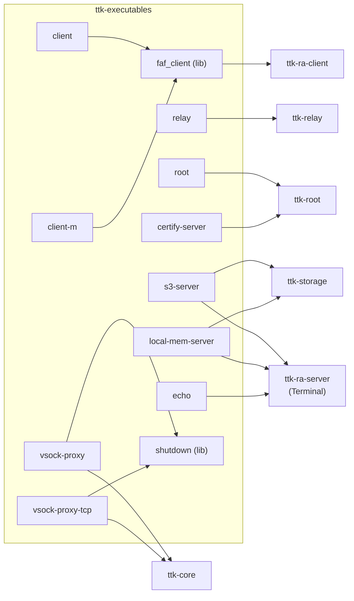
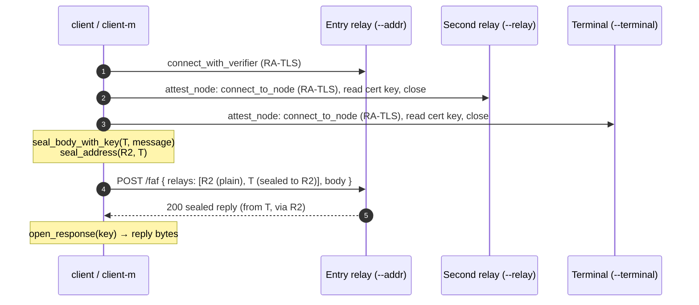

# `ttk-executables` Architecture

Crate reference for `crates/executables`. For the system-level picture, see the [workspace architecture](ARCHITECTURE.md).

Other crates: [`ttk-core`](core.md) · [`ttk-ra-server`](ra-server.md) · [`ttk-ra-client`](ra-client.md) · [`ttk-relay`](relay.md) · [`ttk-root`](root.md) · [`ttk-storage`](storage.md)

> **Role:** **every binary** of the workspace (`src/bin/<name>.rs`); all other crates are libraries. Each bin is a thin entry point over a library. The crate's own small library (`ttk_executables`) holds only what several bins share: the `faf_client` core of the two test clients, and `shutdown`, the signal handling of the two proxies.

## 1. Binaries

| Binary | Runs where | Built on | Purpose |
|---|---|---|---|
| `relay` | Inside the enclave | `ttk_relay::run()` | Relay node |
| `root` | Inside the enclave | `ttk_root::run()` | Root node (accepted images) |
| `s3-server` | Inside the enclave | `Terminal` + `FileService<S3Store>` | File service terminal storing in S3. `required-features = ["s3"]` |
| `local-mem-server` | Dev machine / tests | `Terminal` + `FileService<MemoryStore>` | File service terminal, in memory, nothing persisted |
| `echo` | Inside the enclave, or dev machine | `Terminal` + `Echo` (defined in the bin) | Terminal replying with the decrypted message unchanged (end-to-end route tests) |
| `vsock-proxy` | Parent EC2 instance (Linux) | `ttk_core::{vsock, vsock_proxy, egress}` | Bridges public UDP ↔ enclave vsock, both directions; resolves host names for the enclave |
| `vsock-proxy-tcp` | Parent EC2 instance (Linux) | `ttk_core::{vsock_proxy_tcp, egress}` | Enclave vsock → one fixed TCP remote (S3, or the instance metadata service) |
| `client` | Dev machine / tests only | `faf_client` + `ttk_core::file_message` | Uploads / downloads a file through two relays to a file service terminal |
| `client-m` | Dev machine / tests only | `faf_client` | Sends a text message through two relays (e.g. to `echo`) |
| `certify-server` | Dev machine / tests only | `ttk_root::auth::authorize` | Test CA: attests a node and installs a CA-issued certificate |

Enclave images (`Dockerfile`, `ARG NODE`, Nitro feature only) are built for `relay`, `s3-server`, `root` or `echo`; the test-only tools are never included. All nodes read `Listener::from_env()` (`TTK_USE_UDP`, `TTK_LISTEN_ADDR`, `TTK_VSOCK_PORT`) and log through `env_logger` (`RUST_LOG`).



## 2. `faf_client` (shared library)

Routes one message through two relays to a terminal:

```text
client --> entry relay (--addr) --> second relay (--relay) --> terminal (--terminal)
```



| Item | Description |
|---|---|
| `send(route, message)` | The flow above; logs status, headers and body; returns the decrypted reply, `None` if not `200` (connection, attestation, sealing and decryption errors are `Err`) |
| `attest_node(server, verifier)` | Connect to a node and return its RA-TLS `NodePublicKey` |
| `Route { server_addr, server_name, relay_server, terminal_server }` | Where to send |
| `RouteArgs::new(TTK_SERVER_ADDR, TTK_SERVER_NAME)` / `parse_arg` / `build` | Shared argument parsing: `-s/--server-name`, `-a/--addr`, `-r/--relay`, `-t/--terminal`, positional URL (sets the entry relay and, unless it is `127.0.0.1` or `0.0.0.0`, the SNI name; its path is ignored) |
| `parse_process_args(parse, usage)` | `--help` prints usage and exits `0`; invalid arguments exit `2` |
| `DEFAULT_SERVER_ADDR` / `DEFAULT_SERVER_NAME` / `DEFAULT_RELAY_SERVER` / `DEFAULT_TERMINAL_SERVER` | `127.0.0.1:4433` / `localhost` / `127.0.0.1:4434` / `127.0.0.1:4444` |
| `ClientError` | `Box<dyn Error + Send + Sync>` |

`TTK_ALLOW_MOCK_ATTESTATION=1` makes the verifier accept mock attestation. Every node on the route must already be authorized (CA-issued certificate), otherwise its `/faf` is locked.

## 3. Client tools (test only)

**`client`** (file service):

| Flag | Env | Default |
|---|---|---|
| `-a, --addr` (or positional URL) | `TTK_SERVER_ADDR` | `127.0.0.1:4433` (entry relay) |
| `-s, --server-name` | `TTK_SERVER_NAME` | `localhost` |
| `-r, --relay` | — | `127.0.0.1:4434` (second relay) |
| `-t, --terminal` | — | `127.0.0.1:4444` (terminal) |
| `-u, --upload <PATH>` | — | Upload the file; prints its SHA-256 (checked against the local file) |
| `-d, --download <SHA256>` | — | 64 hex digits; download the file (its SHA-256 is checked) |
| `-o, --out <PATH>` | — | Where `--download` writes (default `./<SHA256>`) |
| — | `TTK_ALLOW_MOCK_ATTESTATION=1` | strict |

Exactly one of `--upload` / `--download`. The payload is a CBOR `FileRequest`; a `not_found` reply is reported as an error.

**`client-m`** (text): the same route flags plus `-m, --message <TEXT>` (required), sent as raw UTF-8; the decrypted reply is logged as text (`<-- Reply: …`).

**`certify-server`**:

| Flag | Default | Meaning |
|---|---|---|
| `-a, --addr` | `127.0.0.1:4433` | Node to authorize |
| `-s, --server-name` | `localhost` | SNI name |
| `--ca-cert <FILE>` | `auth-test-ca.pem` | CA certificate (PEM) |
| `--ca-key <FILE>` | `auth-test-ca.key` | CA private key (PEM PKCS#8) |
| `-o, --out <FILE>` | — | Also write the installed chain (PEM) |

If neither CA file exists, a new root CA is created and written (the key with private permissions); if only one exists, it fails. `TTK_ALLOW_MOCK_ATTESTATION=1` accepts mock attestation. Real nodes trust only the built-in TTK root CA, so a newly created CA is refused by them (`403`); pass the TTK root CA's certificate and key (or an intermediate it issued).

## 4. Parent-instance proxies

Both are Linux only (they error out elsewhere), run in the foreground under systemd, and only move opaque bytes: TLS ends inside the enclave. On `SIGTERM` / `SIGINT` they return from `main` (`ttk_executables::shutdown::shutdown_signal`), so systemd sees a clean exit; a failing listener is an error exit.

**`vsock-proxy`** (QUIC):

| Flag | Env | Default | Meaning |
|---|---|---|---|
| `-c, --cid` | `TTK_ENCLAVE_CID` | required | Enclave CID (e.g. `16`) |
| `-l, --listen` | `TTK_RELAY_LISTEN` | `0.0.0.0:443` | Public UDP address |
| `-p, --vsock-port` | `TTK_VSOCK_PORT` | `5000` | Enclave inbound port |
| `-o, --outbound-port` | `TTK_OUTBOUND_VSOCK_PORT` | `5001` | Outbound port (`0` disables) |
| `-P, --allow-private` | `TTK_ALLOW_PRIVATE_NEXT_HOPS=1` | off | Allow outbound to loopback/private addresses |

| Direction | Behaviour |
|---|---|
| Inbound | One vsock stream to the enclave per client UDP address; framed datagrams both ways |
| Outbound | Accepts vsock from the enclave CID only; reads the destination header (within 5 s), applies `classify_hop_address`, sends datagrams from a dedicated UDP socket, frames replies back |
| DNS | A connection on the outbound port may instead start with a resolve request (the enclave has no DNS): the parent looks the name up (5 s) and answers the addresses `classify_hop_address` permits (`ttk_core::vsock::answer_resolve`), then closes it |
| Limits | Peers idle for 120 s are dropped; at most 4096 (`MAX_VSOCK_PEERS`, the enclave's own cap) peers per direction; 256 datagrams queued per peer |

**`vsock-proxy-tcp`** (TCP, fixed remote):

| Flag | Env | Default | Meaning |
|---|---|---|---|
| `-c, --cid` | `TTK_ENCLAVE_CID` | required | Only connections from this CID are accepted |
| `-r, --remote <HOST:PORT>` | `TTK_TCP_REMOTE` | required | The only destination, resolved by the parent on each connection |
| `-p, --vsock-port` | `TTK_TCP_VSOCK_PORT` | `8001` | vsock port to listen on |
| `-P, --allow-private` | `TTK_ALLOW_PRIVATE_NEXT_HOPS=1` | off | Remote may resolve to loopback/private addresses |
| `-I, --allow-imds` | `TTK_TCP_ALLOW_IMDS=1` | off | Remote may be the instance metadata service (`169.254.169.254`, `fd00:ec2::254`); every other link-local address stays refused |

At most 1024 connections are forwarded at once; resolving and connecting to the remote has 10 s. Deployed twice for `s3-server`: `vsock-proxy-tcp.service` (vsock `8001` → `s3.<region>.amazonaws.com:443`) and `vsock-proxy-imds.service` (vsock `8002` → `169.254.169.254:80`, `--allow-imds`).

## 5. Features and tests

Features `nitro`, `mock` (default), `sev-snp`, `tdx` forward to `ttk-ra-server`, `ttk-relay`, `ttk-storage` and `ttk-root`; `s3` enables `ttk-storage/s3` (needed by `s3-server`). On Linux the crate also pulls in `bytes` and `tokio-vsock` for the proxies.

| File | Covers |
|---|---|
| `crates/executables/tests/client_bin_tests.rs` | `client` against in-process relays and a file service terminal: upload/download round trip, missing file, route errors, mock opt-in, usage, argument errors, SNI from flag / URL |
| `crates/executables/tests/client_m_bin_tests.rs` | `client-m` through two relays to an in-process terminal with a copy of `echo`'s evaluator; the `echo` process attests and keeps `/faf` locked (it trusts only the built-in TTK root CA, so tests cannot unlock it) |
| `crates/executables/tests/auth_test_bin_tests.rs` | `certify-server` against a root node trusting a throwaway CA: installs a certificate, writes the chain, mock opt-in, a created CA is refused, unusable CA, usage |
| `crates/executables/tests/node_bin_tests.rs` | `relay`, `root` (and `s3-server`) exit with an error on an invalid listener configuration |
| `crates/executables/tests/vsock_proxy_bin_tests.rs` | `vsock-proxy` / `vsock-proxy-tcp` usage, argument errors, refusal to run without vsock off Linux |
| `crates/executables/tests/vsock_proxy_relay_tests.rs` | Both proxies against a test enclave over vsock loopback (skipped without it): inbound and outbound relaying, DNS for the enclave, the egress policy, malformed and foreign connections, bind failures, clean shutdown |
