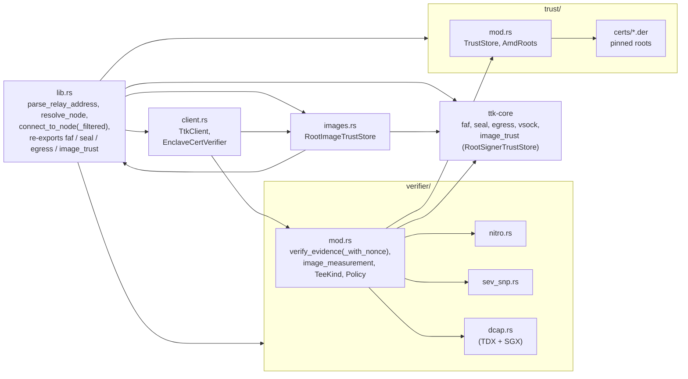
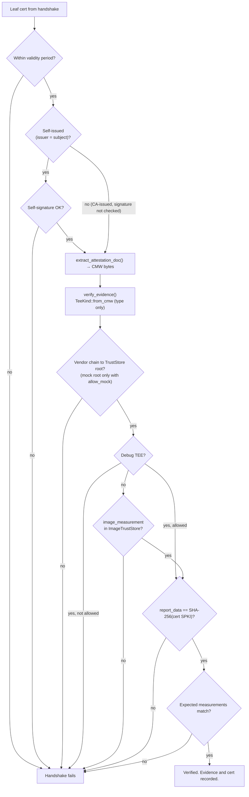

# `ttk-ra-client` Architecture

Crate reference for `crates/ra-client`. For the system-level picture, see the [workspace architecture](ARCHITECTURE.md).

Other crates: [`ttk-core`](core.md) · [`ttk-ra-server`](ra-server.md) · [`ttk-relay`](relay.md) · [`ttk-root`](root.md) · [`ttk-storage`](storage.md) · [`ttk-executables`](executables.md)

> **Role:** the RATS **Verifier / Relying Party**. Connects to nodes over HTTP/3 and verifies their evidence during the TLS handshake (including the enclave image, against the list fetched from the root servers), whether the node presents its self-signed or its CA-issued RA-TLS certificate. Also the client side of `/faf`: relay-address parsing, resolving and connecting to the nodes of a route (the format and sealing are re-exported from `ttk-core`). Used by the relay, by `ttk_root::auth` and by the client binaries. Depends on `ttk-core`, never on `ttk-ra-server`.

## 1. Modules

| File | Responsibility |
|---|---|
| `crates/ra-client/src/lib.rs` | Declares modules; re-exports `client.rs` at the crate root, plus `RootImageTrustStore`, `TrustStore`, `ttk_core::image_trust::{ImageTrustStore, ImageMeasurement, RootSignerTrustStore, parse_image_allowlist}`, `ttk_core::faf::*`, `ttk_core::egress::{classify_hop_address, HopAddressClass}` and `ttk_core::seal` (as `seal`); `parse_relay_address`, `parse_relay_server`, `resolve_node`, `connect_to_node(_filtered)`, `RELAY_CONNECT_TIMEOUT` |
| `crates/ra-client/src/client.rs` | `TtkClient`, `ClientTransport`, `ClientResponse`, `EnclaveCertVerifier`, `extract_attestation_doc`, `hex_encode`, response limits |
| `crates/ra-client/src/verifier/mod.rs` | `verify_evidence` / `verify_evidence_with_nonce` (CMW dispatch, debug policy, image check, key and nonce binding), `image_measurement`, `check_image_allowed`, `VerifiedEvidence`, `TeeKind`, `Policy`, `is_bound_to` |
| `crates/ra-client/src/verifier/nitro.rs` | NSM document: COSE_Sign1 (ES384), cert chain to AWS Nitro root (or the mock root, if allowed) |
| `crates/ra-client/src/verifier/sev_snp.rs` | SEV-SNP: ARK → ASK → VCEK or ARK → ASVK → VLEK chain, key/report match, report signature |
| `crates/ra-client/src/verifier/dcap.rs` | TDX/SGX DCAP quote: PCK chain to Intel root, QE report, quote signature |
| `crates/ra-client/src/trust/mod.rs` | `TrustStore`, `AmdRoots`/`AmdProduct`. Data only |
| `crates/ra-client/src/trust/certs` | Pinned roots: AWS Nitro G1, Intel SGX Root CA, AMD Milan/Genoa/Turin ARK + ASK + ASVK (mock root from `ttk-core`) |
| `crates/ra-client/src/images.rs` | `RootImageTrustStore`: fetching `GET /root-attestation` from `ROOT_SERVERS`, each root attested against `ttk_core::RootSignerTrustStore`; lazy process-wide cache |

The crate has no binary: the `client` / `client-m` test tools live in [`ttk-executables`](executables.md).

## 2. `TtkClient`

| Method | Description |
|---|---|
| `connect(addr, sni)` | Connect with the default strict verifier |
| `connect_with_verifier(addr, sni, verifier)` | Connect with a custom `EnclaveCertVerifier` |
| `connect_over(transport, addr, sni, verifier)` | Same, over `ClientTransport::Udp` or `Vsock { cid, port }` |
| `get(path)` / `post(path, body)` / `post_json(path, &T)` / `send(...)` | HTTP/3 requests; each is its own stream, so one client can be shared via `Arc`. Responses over `MAX_RESPONSE_BODY` (1 MiB) fail; headers capped at `MAX_RESPONSE_HEADERS` (16 KiB) |
| `server_addr()` / `server_name()` | Connection target |
| `peer_cert()` / `peer_cert_sha256()` / `peer_cert_sha256_hex()` | The attested certificate |
| `is_closed()` | `true` after idle timeout or peer close |
| `close()` | Graceful shutdown |

## 3. `EnclaveCertVerifier`

A rustls `ServerCertVerifier` that replaces CA validation with attestation checks. It accepts both forms of a node's RA-TLS certificate: the **self-signed** one from startup, and the **CA-issued** one installed by `POST /certificate` (same key, same evidence extension). A CA-issued certificate's signature is deliberately **not** checked: no CA is trusted here, trust comes from the evidence and its binding to the key.

| Builder | Effect |
|---|---|
| `new()` | Strict: genuine TEE only, no debug, built-in roots, accepted images from the root servers (fetched on first need) for every TEE |
| `with_expected_measurement(name, value)` | Pin a measurement (e.g. `pcr0`, `measurement`, `mrtd`) |
| `with_expected_pcr(index, value)` | Shortcut for `pcr{index}` |
| `with_trust_store(store)` | Custom vendor roots |
| `with_image_trust_store(images)` / `with_shared_image_trust_store(arc)` | Replace the fetched image list (tests, private deployments, root-server attestation, `ttk_root::auth`) |
| `allow_mock()` | Also trust the mock root CA (whose key is public) and accept mock documents' debug-mode PCRs; still fully verified. Debug evidence from a real TEE still needs `allow_debug`. Dev only |
| `allow_debug()` | Accept debug-mode TEEs (their image is not checked) |
| `received_certificate()` / `verified_evidence()` / `verified_attestation()` | Results after a handshake |

The TLS handshake signature is then verified against the same certificate, proving the peer holds the attested key. Never reuse this verifier for ordinary (non RA-TLS) TLS.

## 4. Evidence verifiers

| TEE | Module | Checks | Not checked |
|---|---|---|---|
| AWS Nitro | `verifier::nitro` | COSE_Sign1 ES384 signature, `cabundle` chain to AWS Nitro root (or mock root if allowed), timestamp ≤ now + 5 min; debug = all-zero PCR0 | — |
| AMD SEV-SNP | `verifier::sev_snp` | `SIGNING_KEY` flags pick VCEK or VLEK; ARK → ASK → VCEK or ARK → ASVK → VLEK (RSA-PSS), validity, VCEK `hwID` (VLEKs are not chip-specific) and TCB match report, report ECDSA P-384 signature | CRLs |
| Intel TDX / SGX | `verifier::dcap` | PCK chain to Intel SGX Root CA, QE report signed by PCK and not debug, QE binds the attestation key, quote signature | TCB status, QE identity, PCK CRLs |

The per-TEE verifiers check signatures only; images, the debug policy and the binding are checked once, for every TEE, in `verifier::mod`:

| Function | Description |
|---|---|
| `verify_evidence(cmw, binding, now, trust, images, policy)` | Per-TEE verifier, then: debug evidence refused unless `allow_debug` (or `allow_mock` for a mock document); non-debug evidence's image checked (`check_image_allowed`); report data bound to `binding` (SHA-256 of the cert SPKI, zero-padded). Returns `VerifiedEvidence { tee, report_data, measurements, debug, mock, nitro }` |
| `verify_evidence_with_nonce(cmw, binding, nonce, now, trust, images, policy)` | Same, for a `POST /evidence` answer: Nitro's `nonce` field must equal `nonce`; TDX / SGX / SEV-SNP report data must be `binding ‖ SHA-256(nonce)` (`ttk_core::fresh_evidence::report_data`). Used by `ttk_root::auth::verify_fresh_evidence` |
| `image_measurement(evidence, kind)` | The measurement an `ImageTrustStore` of `kind` lists (table below) |
| `check_image_allowed(evidence, images)` | That measurement is in `images.image_allowlist()` |

| TEE | Measurement names | `ImageMeasurement::Image` | `ImageMeasurement::Signer` |
|---|---|---|---|
| Nitro | `pcr0` … `pcrN` | `pcr0` | `pcr8` |
| SEV-SNP | `measurement`, `host_data`, `id_key_digest`, `author_key_digest` | `measurement` | `id_key_digest` |
| TDX | `mrtd`, `rtmr0`–`rtmr3`, `mrseam`, `mrconfigid`, `mrowner`, `mrownerconfig` | SHA-384(`mrtd` ‖ `rtmr0` ‖ `rtmr1` ‖ `rtmr2`) | none (error) |
| SGX | `mrenclave`, `mrsigner` | `mrenclave` | `mrsigner` |

## 5. Trust stores and accepted images

| Item | Module | Description |
|---|---|---|
| `TrustStore { aws_nitro_root, mock_nitro_root, intel_sgx_root, amd }` | `trust` | Vendor roots; `builtin()` / `Default` |
| `AmdRoots { product, ark, ask, asvk }`, `AmdProduct` | `trust` | Milan, Genoa, Turin (ASK signs VCEKs, ASVK signs VLEKs) |
| `RootSignerTrustStore { signer_allowlist }` | `ttk_core` (re-exported) | `ImageTrustStore` for the root servers: signers (`Signer`) from `crates/core/src/certs/root_signer_allowlist.txt` |
| `RootImageTrustStore { image_allowlist }` | `images` | `ImageTrustStore` with the image measurements fetched from the root servers |
| `RootImageTrustStore::fetch(roots, transport, verifier)` | `images` | First root that answers, `ROOT_FETCH_TIMEOUT` (10 s) each; empty list is an error |
| `RootImageTrustStore::fetch_builtin(transport)` | `images` | `ROOT_SERVERS`, attested against `RootSignerTrustStore` |
| `RootImageTrustStore::builtin()` | `images` | Blocking fetch on its own thread (safe inside Tokio); **fails closed** to an empty list |
| `set_root_transport(transport)` | `images` | Process-wide transport for `builtin()` (relay sets vsock) |
| `ROOT_SERVERS` | `images` | `a.root.ttk-servers.net:443`, `b.root.ttk-servers.net:443` |
| `ROOT_FETCH_RETRY_INTERVAL` | `images` | 60 s before a failed fetch is retried |

A verifier built without `with_image_trust_store` uses a lazy handle: the process-wide list is fetched only the first time an allowlist is actually needed (non-debug evidence of any TEE), then shared by every verifier. Root nodes gate `GET /root-attestation` like every other route, so they must be authorized (CA-issued certificate) before anyone can fetch from them.

## 6. `/faf` client side

| Item | Description |
|---|---|
| `FafRequest`, `FafRelay`, `FafBody`, `FAF_PATH`, `DEFAULT_RELAY_PORT` | Re-exported from `ttk_core::faf` (see [core](core.md)) |
| `seal` | `ttk_core::seal`, re-exported as a module |
| `classify_hop_address`, `HopAddressClass` | Re-exported from `ttk_core::egress` |
| `RELAY_CONNECT_TIMEOUT` | 3 s per resolved address |
| `parse_relay_address(addr, salt_required)` | Strip and validate the 10-digit salt |
| `parse_relay_server(server)` | `host[:port]` / `https://host[:port]` → `(host, port)`; rejects other schemes and user info |
| `resolve_node(transport, host, port)` | IP literals as is; host names via the system resolver over `Udp`, or via the parent's `vsock-proxy` over `Vsock` (`ttk_core::vsock::resolve_via_parent`: an enclave has no DNS). The answer is untrusted |
| `connect_to_node(transport, host, port, verifier)` | `resolve_node`, then try each address until one attests |
| `connect_to_node_filtered(..., allow)` | Same, skipping addresses `allow` refuses (relay egress policy) |

## 7. Features and tests

No features of its own. Tests dev-depend on `ttk-ra-server` (with `mock`, `sev-snp`, `tdx`), `ttk-relay`, `ttk-storage` and `ttk-root`, which themselves depend on `ttk-ra-client`. Because of this dev-dependency cycle, don't pass `ttk_ra_client` types into relay/terminal APIs in tests (they are distinct types); use `Relay::allow_mock()`, not `with_verifier`.

| File | Covers |
|---|---|
| `crates/ra-client/tests/client_tests.rs` | Helpers, `EnclaveCertVerifier` against mock evidence: binding, PCRs, validity, missing extension, self-signed vs CA-issued certificates, TLS 1.2/1.3 signatures |
| `crates/ra-client/tests/client_e2e_tests.rs` | `TtkClient` against an in-process `ttk-ra-server` server |
| `crates/ra-client/tests/verifier_tests.rs` | Evidence verification with real vendor fixtures and synthetic PKIs: image measurements per TEE, debug / mock policy, nonces, VLEK chains |
| `crates/ra-client/tests/images_tests.rs` | Fetching accepted images from local root nodes: success, fallback, failure, root attestation |
| `crates/ra-client/tests/faf_tests.rs` | Relay address parsing, node resolution and the egress policy (format and sealing are tested in `ttk-core`) |
| `crates/ra-client/tests/sev_snp_provider_tests.rs` | Server SEV-SNP provider against emulated configfs-tsm (VCEK and VLEK tables, nonces) |
| `crates/ra-client/tests/tdx_provider_tests.rs` | Server TDX provider against emulated configfs-tsm (nonces) |
