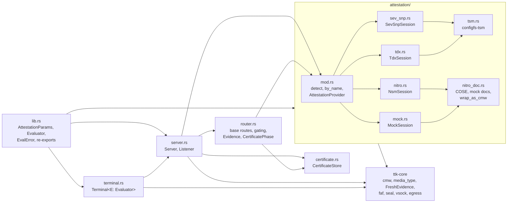
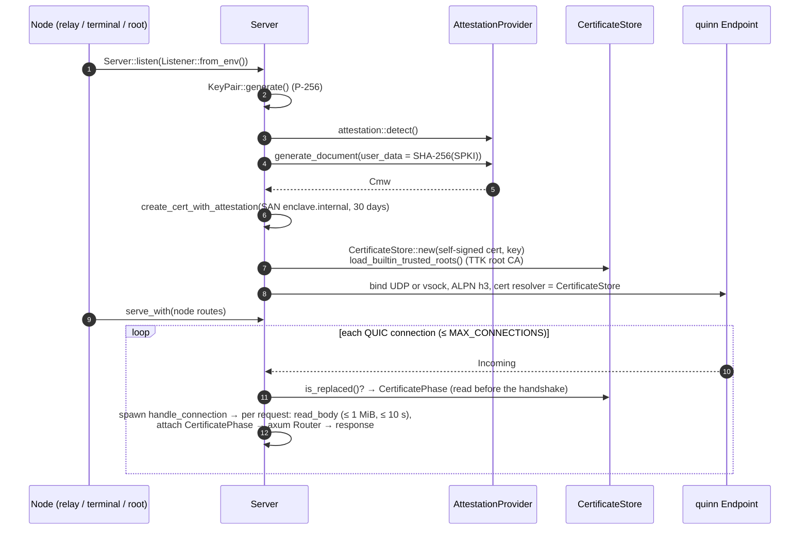
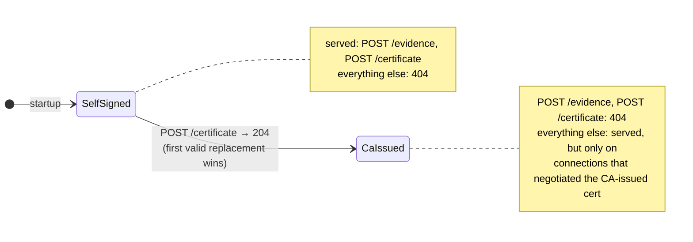
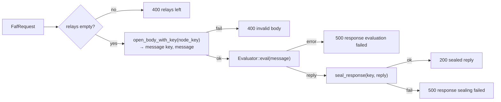

# `ttk-ra-server` Architecture

Crate reference for `crates/ra-server`. For the system-level picture, see the [workspace architecture](ARCHITECTURE.md).

Other crates: [`ttk-core`](core.md) · [`ttk-ra-client`](ra-client.md) · [`ttk-relay`](relay.md) · [`ttk-root`](root.md) · [`ttk-storage`](storage.md) · [`ttk-executables`](executables.md)

> **Role:** the RATS **Attester**, and the **terminal node**. Library only. Generates evidence at startup, wraps it in a CMW, puts it in a self-signed RA-TLS certificate and serves HTTP/3; serves fresh evidence on request; lets a trusted CA replace the certificate once (`POST /certificate`) and gates every other route on that replacement. The `terminal` module adds the last hop of `POST /faf`, answered by an `Evaluator`. Contains no relay or client logic and does not depend on `ttk-ra-client`: the `/faf` format and sealing come from `ttk-core`.

## 1. Modules

| File | Responsibility |
|---|---|
| `crates/ra-server/src/lib.rs` | Declares modules; `AttestationParams { user_data, nonce, public_key }`; the `Evaluator` trait and `EvalError`; re-exports `cmw`, `Cmw*`, and `ttk_core::{egress, vsock}` |
| `crates/ra-server/src/server.rs` | Attestation at startup, RA-TLS certificate, QUIC/HTTP/3 accept loop, listener config, limits, per-connection `CertificatePhase` |
| `crates/ra-server/src/certificate.rs` | `CertificateStore`: the presented chain (rustls `ResolvesServerCert`), its one-time replacement by a CA-issued certificate, trusted roots |
| `crates/ra-server/src/router.rs` | Base routes `GET /`, `GET /evidence.cmw`, `POST /evidence`, `POST /certificate`; the route gating; `Evidence`, `CertificatePhase` |
| `crates/ra-server/src/terminal.rs` | The terminal node: `POST /faf` last hop, answered by an `Evaluator` |
| `crates/ra-server/src/attestation/mod.rs` | `AttestationProvider` trait, `AttestationError`, provider detection; re-exports `ttk_core::{cmw, media_type, MOCK_NITRO_ROOT_CERT}` |
| `crates/ra-server/src/attestation/nitro.rs` | AWS Nitro provider over `/dev/nsm` |
| `crates/ra-server/src/attestation/mock.rs` | Mock provider: Nitro-format documents signed by the published mock root CA |
| `crates/ra-server/src/attestation/nitro_doc.rs` | COSE_Sign1 payload extraction and parsing, mock document creation (key `mock_nitro_root_key.pk8`), `wrap_as_cmw` |
| `crates/ra-server/src/attestation/sev_snp.rs` | AMD SEV-SNP provider (report + VCEK), `wrap_evidence_as_cmw` |
| `crates/ra-server/src/attestation/tdx.rs` | Intel TDX provider (DCAP quote), `wrap_quote_as_cmw` |
| `crates/ra-server/src/attestation/tsm.rs` | Linux configfs-tsm request handling, shared by SEV-SNP and TDX |
| `crates/ra-server/tests/support/test_ca.rs` | Test support only (not a library module): `SignForTests::sign_for_tests()` |

## 2. Server lifecycle

The provider is kept (`Arc<dyn AttestationProvider>`) so `POST /evidence` can request fresh evidence later. The `CertificateStore` is shared by the TLS config (it resolves the presented chain for every handshake) and the router (`POST /certificate`, the gating).

## 3. Certificate replacement and route gating

A node starts with a **self-signed** RA-TLS certificate and serves almost nothing. An external CA (see [`ttk_root::auth`](root.md#5-auth-the-test-certificate-authority) and the `certify-server` binary) appraises the node and installs a **CA-issued** certificate for the same key; only then are the node's routes served.

`CertificateStore::replace(chain)` accepts a chain only if:

| Check | Refusal (`POST /certificate` status) |
|---|---|
| Body is a PEM chain (leaf first) or one DER certificate (`parse_chain`) | `400` `Malformed` |
| Leaf has the **same SubjectPublicKeyInfo** and the **same attestation extension** (byte for byte) as the current certificate | `422` `Mismatch` |
| Chain validates (rustls `WebPkiServerVerifier`, Web PKI path building) to a trusted root, is currently valid and names `CERT_DNS_NAME` (`enclave.internal`) | `403` `Untrusted` |
| Trusted roots are configured: the built-in `ttk_core::TTK_ROOT_CA_PEM` unless `Server::set_trusted_roots` overrides it (empty = refuse all) | `503` `NoTrustedRoots` |
| Not already replaced (atomic: concurrent valid replacements, only the first wins) | `404` `AlreadyReplaced` |

On success the new chain is presented to **new** handshakes; open connections keep their certificate. Because the key and the evidence extension are unchanged, RA-TLS clients still verify the node exactly as before.

The gating is done in `build_router`, so it covers every route a node adds with `serve_with`:

| Routes | Gate | Served when |
|---|---|---|
| `POST /evidence`, `POST /certificate` (bootstrap) | `require_self_signed` | `CertificateStore::is_replaced()` is `false` |
| `GET /`, `GET /evidence.cmw`, and every node route (`/faf`, `/root-attestation`, …) | `require_ca_issued` | The request carries `CertificatePhase::CaIssued` |

`CertificatePhase` is read **before** the TLS handshake and attached to every request of the connection. Replacement only goes one way, so `CaIssued` proves the CA-issued certificate was presented; a connection opened with the self-signed certificate stays locked even after the replacement, and a replacement racing a handshake leaves that connection locked. A locked route answers `404` whatever the method (no `405`).

## 4. Public API

**Crate root**

| Item | Kind | Description |
|---|---|---|
| `AttestationParams { user_data, nonce, public_key }` | struct | Request to an attestation provider (`Default`) |
| `Evaluator` | trait | `eval(message) -> Future<Result<Vec<u8>, EvalError>> + Send`: decrypted `/faf` message → plaintext reply. Implementations: `ttk_storage::FileService`, `Echo` (bin `echo`) |
| `EvalError` | type | `Box<dyn Error + Send + Sync>` (unlike `BoxError`, usable across `.await` in `Send` futures) |

**`server`**

| Item | Kind | Description |
|---|---|---|
| `Server::bind(addr)` | fn | Attest and bind a UDP QUIC endpoint (port `0` = free port) |
| `Server::bind_vsock(port)` | fn (Linux) | Attest and listen on a vsock port |
| `Server::listen(listener)` | fn | Bind UDP or vsock based on `Listener`, and log where |
| `Server::serve()` | async fn | Serve the base routes |
| `Server::serve_with(router)` | async fn | Serve base routes merged with a node's own routes (all gated) |
| `Server::local_addr()` / `evidence()` / `private_key_der()` | fn | Bound address, `Evidence`, RA-TLS private key (PKCS#8 DER) |
| `Server::certificate_chain()` | fn | The chain currently presented (leaf first) |
| `Server::set_trusted_roots(roots)` | fn | Override the built-in TTK root CA (tests, private CAs); empty = refuse all replacements |
| `Server::replace_certificate(chain)` | fn | Same path as `POST /certificate` (`CertificateStore::replace`) |
| `Listener` | enum | `Udp(SocketAddr)` or `Vsock(u32)`; `Listener::from_env()` |
| `create_cert_with_attestation(key, dns_name, cmw, days)` | fn | Self-signed cert, SAN = `dns_name`, with the CMW as a non-critical extension |
| `ATTESTATION_OID`, `PARENT_CID`, `BoxError` | re-exports | From `ttk-core` |
| `USE_UDP_ENV`, `LISTEN_ADDR_ENV`, `VSOCK_PORT_ENV` | consts | `TTK_USE_UDP`, `TTK_LISTEN_ADDR`, `TTK_VSOCK_PORT` |
| `MAX_REQUEST_BODY` | const | 1 MiB; larger bodies get `413` |
| `REQUEST_BODY_TIMEOUT` | const | 10 s; slower bodies get `408` |
| `MAX_REQUEST_HEADERS` | const | 16 KiB header section |
| `MAX_CONNECTIONS` | const | 1024 concurrent QUIC connections |
| `MAX_STREAMS_PER_CONNECTION` | const | 16 concurrent requests per connection |
| `CONNECTION_RECEIVE_WINDOW` | const | 4 MiB per connection |
| `env_u32(name, default)` | fn | Read a `u32` env var |

**`certificate`**

| Item | Description |
|---|---|
| `CertificateStore` | `new(cert, key)`, `set_trusted_roots`, `load_builtin_trusted_roots`, `has_trusted_roots`, `current_chain`, `is_replaced`, `replace(chain)`; implements `ResolvesServerCert` |
| `CertificateError` | `Malformed`, `Mismatch`, `Untrusted`, `NoTrustedRoots`, `AlreadyReplaced` |
| `CERT_DNS_NAME` | `"enclave.internal"` |
| `parse_chain(body)` | PEM `CERTIFICATE` blocks, or one DER certificate |

**`router`**

| Item | Description |
|---|---|
| `build_router(evidence, provider, certificates, routes)` | Base routes merged with `routes`, gated |
| `Evidence { cmw }` | CBOR CMW generated at startup |
| `CertificatePhase` | `SelfSigned` / `CaIssued`, attached per connection by the server |
| `MAX_NONCE_LEN` | 512 bytes (the NSM's `nonce` limit) |
| `MAX_CONCURRENT_ATTESTATIONS` | 4; further `POST /evidence` get `503` |

| Route | Phase | Response |
|---|---|---|
| `GET /` | CA-issued | Greeting text |
| `GET /evidence.cmw` | CA-issued | Base64 CBOR CMW from startup |
| `POST /evidence` | self-signed | Body = raw nonce (1..=512 bytes, else `400`). Base64 CBOR `FreshEvidence`: new Evidence with `user_data` = SHA-256 of the presented cert's SPKI and the nonce in the Nitro document, plus that DER cert. `503` when busy; `500` on failure, always for TDX / SEV-SNP |
| `POST /certificate` | self-signed | Body = CA-issued chain. `204`, or `400` / `422` / `403` / `503` / `404` (see section 3) |

**`terminal`**

| Item | Kind | Description |
|---|---|---|
| `Terminal::new(server, evaluator)` | fn | Wrap a `Server`, answering `/faf` with `evaluator` |
| `Terminal::bind(addr, evaluator)` | fn | Attest and bind UDP |
| `Terminal::local_addr()` / `server()` | fn | Bound address; the wrapped `Server` (e.g. for `sign_for_tests`) |
| `Terminal::serve()` | async fn | Serve base routes + `POST /faf` |

There is no default evaluator and no `run()`: the binaries (`s3-server`, `local-mem-server`, `echo`) build the terminal with their own evaluator.

**`attestation`**

| Item | Kind | Description |
|---|---|---|
| `AttestationProvider` | trait | `name()`, `is_available()`, `generate_document(&AttestationParams) -> Cmw` |
| `detect()` | fn | `TTK_ATTESTATION` if set, else probe Nitro → SEV-SNP → TDX, else `mock` (if compiled), else `NoProvider` |
| `by_name(name)` | fn | Open `aws-nitro`, `sev-snp`, `tdx` or `mock` |
| `PROVIDER_ENV` | const | `TTK_ATTESTATION` |
| `AttestationError` | enum | `DeviceOpenFailed`, `Driver`, `UnexpectedResponse`, `InvalidInput`, `DocumentDecodingFailed`, `Unsupported`, `NoProvider`, `Io` |

## 5. Terminal: `POST /faf`

| Status | When |
|---|---|
| `200` | Body decrypted and evaluated; the body is the evaluator's reply sealed under the message key (base64 `nonce ‖ AES-256-GCM`). Relays pass it back unchanged and the client opens it with `open_response` |
| `400` | Relays still present, or body can't be decrypted |
| `404` | Node not authorized yet, or connection opened with the self-signed cert (gating) |
| `408` / `413` | Body too slow / > 1 MiB (server) |
| `500` | Evaluator failed (no detail, so relays learn nothing about the message), or the reply couldn't be sealed |

The handler never logs the key or the message, only the message size. An application-level failure (e.g. a missing file) is the evaluator's business: `FileService` answers it as an ordinary sealed `200` reply.

## 6. Attestation providers

| Provider | Feature | Hardware interface | CMW | Extra config |
|---|---|---|---|---|
| `NsmSession` | `nitro` | `/dev/nsm` | record `AWS_NITRO`: NSM document (COSE_Sign1) | — |
| `MockSession` | `mock` | none | record `AWS_NITRO`: mock-signed NSM-format document, all-zero PCRs | — |
| `SevSnpSession` | `sev-snp` | `/sys/kernel/config/tsm/report` | collection `SEV_SNP_COLLECTION`: `report` + `vcek` | `TTK_SEV_SNP_VCEK` if the host supplies no VCEK |
| `TdxSession` | `tdx` | `/sys/kernel/config/tsm/report` | record `TDX`: DCAP quote | — |

TDX and SEV-SNP bind 64 bytes of report data (`user_data`, zero-padded); `nonce` and `public_key` are rejected for them. `NsmSession` also exposes `describe_nsm`, `get_random`, and PCR helpers (`describe_pcr`, `extend_pcr`, `lock_pcr`).

## 7. Features and dependencies

| Feature | Default | Pulls in |
|---|:---:|---|
| `nitro` | ✅ | `aws-nitro-enclaves-nsm-api` |
| `mock` | ✅ | `aws-nitro-enclaves-nsm-api` |
| `sev-snp` | — | — |
| `tdx` | — | — |

Main dependencies: `ttk-core`, `quinn`, `h3`, `h3-quinn`, `axum`, `rustls` (ring), `rcgen`, `ciborium`, `sha2`, `x509-parser`.

## 8. Tests

Node tests that call anything but `POST /evidence` / `POST /certificate` first unlock the routes with `sign_for_tests()` from `tests/support/test_ca.rs`: it makes a throwaway CA the only trusted root (`set_trusted_roots`) and installs a certificate it issues via `replace_certificate`. Other crates include it with `#[path = "../../ra-server/tests/support/test_ca.rs"] mod test_ca;` and call `node.server().sign_for_tests()`.

| File | Covers |
|---|---|
| `crates/ra-server/tests/attestation_tests.rs` | Provider selection and errors |
| `crates/ra-server/tests/certificate_tests.rs` | `POST /certificate`: accepted chains (direct, via intermediate), every refusal, one replacement only, bootstrap routes gone afterwards, gating before and after |
| `crates/ra-server/tests/nitro_tests.rs` | Nitro / mock documents (mock off-enclave) |
| `crates/ra-server/tests/router_tests.rs` | `POST /evidence` over the mock provider: nonce, key binding, certificate, bad nonces |
| `crates/ra-server/tests/tsm_tests.rs` | configfs-tsm requests against an emulated directory |
| `crates/ra-server/tests/integration_test.rs` | Test identity generation, request handling, Nitro + CMW integration |

The terminal is tested from `ttk-storage` (`terminal_tests.rs`, `file_service_tests.rs`); the SEV-SNP and TDX providers from `ttk-ra-client` (`sev_snp_provider_tests.rs`, `tdx_provider_tests.rs`), next to their verifiers.
