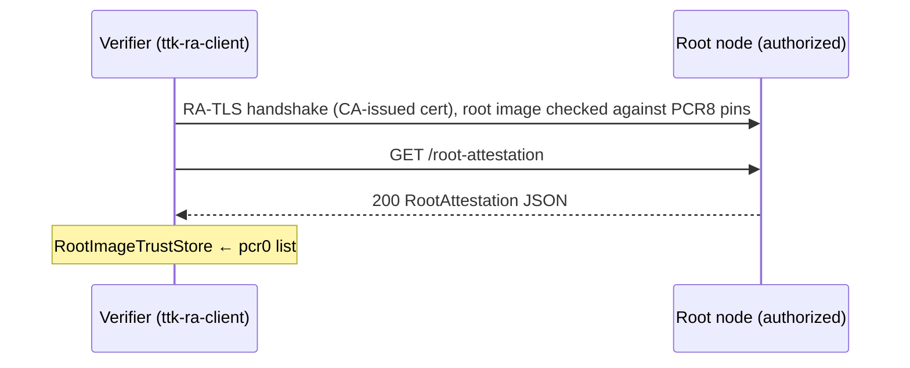
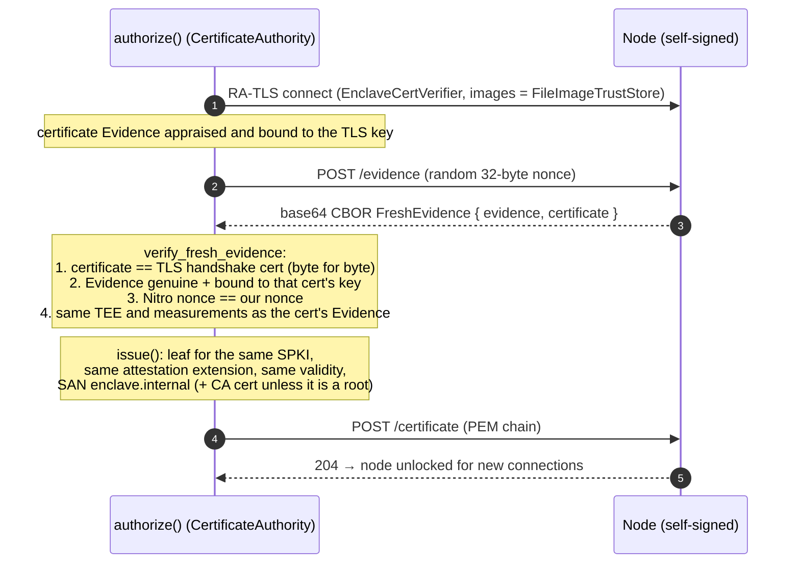

# `ttk-root` Architecture

Crate reference for `crates/root`. For the system-level picture, see the [workspace architecture](ARCHITECTURE.md#5-accepted-enclave-images-root-servers).

Other crates: [`ttk-core`](core.md) · [`ttk-ra-server`](ra-server.md) · [`ttk-ra-client`](ra-client.md) · [`ttk-relay`](relay.md) · [`ttk-storage`](storage.md) · [`ttk-executables`](executables.md)

> **Role:** an attested node that publishes the **reference values**: the PCR0 checksums of the accepted enclave images. Clients and relays fetch them over RA-TLS (so the list is bound to an attested enclave) and reject non-debug Nitro evidence from any other image. The crate also holds `auth`, a **test certificate authority** that appraises a node (startup and fresh evidence) and installs a CA-issued RA-TLS certificate for it; it is what the `certify-server` binary runs.

## 1. Files

| File | Responsibility |
|---|---|
| `crates/root/src/lib.rs` | `Root`, `FileImageTrustStore`, `run()`, `GET /root-attestation` handler |
| `crates/root/src/auth.rs` | Test CA: `CertificateAuthority`, `authorize`, `verify_fresh_evidence` |
| `crates/root/src/nitro_image_allowlist.txt` | The accepted PCR0 values, compiled in: one 96-hex-char SHA-384 per line, `#` comments |

Library only: the `root` binary (`env_logger::init()` + `ttk_root::run()`) and `certify-server` live in [`ttk-executables`](executables.md).

Dependencies: `ttk-core`, `ttk-ra-server`, and (for `auth`, which is always built) `ttk-ra-client`, `rcgen`, `rand_core`, `x509-parser`. `ttk-ra-client` in turn dev-depends on `ttk-root` for its image-fetch tests.

## 2. Public API

| Item | Kind | Description |
|---|---|---|
| `run()` | async fn | `Root::new(Server::listen(Listener::from_env()?))` then serve |
| `Root::new(server)` | fn | Wrap a `ttk-ra-server` `Server`, serving the built-in allowlist |
| `Root::with_image_trust_store(server, images)` | fn | Serve the images of any `ImageTrustStore` |
| `Root::bind(addr)` | fn | Attest and bind UDP |
| `Root::local_addr()` / `server()` / `serve()` | fn | Bound address; the wrapped `Server`; serve base routes + `GET /root-attestation` |
| `FileImageTrustStore { nitro_image_allowlist }` | struct | `ImageTrustStore` from allowlist text; `parse(text)`, `builtin()` |
| `RootAttestation`, `ROOT_ATTESTATION_PATH` | re-exports | From `ttk_core::image_trust` |

## 3. `GET /root-attestation`

```json
{
  "hash_algorithm": "SHA384",
  "pcr0": ["9a800a707a9feb9f…", "e523396bacac00fe…"]
}
```

The response is built once at startup from the image trust store and served as JSON (`200`). Clients decode it with `RootAttestation::pcr0_values()`, which checks the algorithm and every entry; an empty list is treated as a failure.

Like every route, it answers `404` until the root node has a CA-issued certificate (and then only on connections that negotiated it). **Root nodes must therefore be authorized before the nodes and clients that fetch from them.**



## 4. Releasing a new image

1. `scripts/build-eif.sh <arch> <relay|s3-server>` prints the image's PCR0 (`out/ttk-<node>_v<ver>_<arch>.json`).
2. Add it to `crates/root/src/nitro_image_allowlist.txt`.
3. Rebuild and redeploy the root EIF (`scripts/build-eif.sh <arch> root`). Its PCR8 must be in `crates/ra-client/src/trust/root_signer_pcr8.txt`, which needs the EIF to be signed (`nitro-cli build-enclave --signing-certificate … --private-key …`).
4. After every (re)start, authorize the root node first, then the others (the RA-TLS key is ephemeral, so each start needs a new CA-issued certificate).

## 5. `auth`: the test certificate authority



| Item | Description |
|---|---|
| `CertificateAuthority::generate(cn)` | New self-signed root CA (`CA_VALIDITY_DAYS` = 3650) |
| `CertificateAuthority::from_pem(cert, key)` | Load any CA (root or intermediate); the subject is rebuilt for `rcgen` |
| `cert_pem()` / `key_pem()` / `cert_der()` | Export |
| `issue(ra_tls_cert)` | Leaf for the node's RA-TLS key with its attestation extension, `CERT_DNS_NAME`, `ServerAuth`; chain = leaf (+ CA cert unless self-signed) |
| `authorize(addr, server_name, ca, options)` | The full flow above; returns the installed chain |
| `AuthorizeOptions { allow_mock, images }` | Mock attestation (dev only); accepted images (default `FileImageTrustStore::builtin()`) |
| `verify_fresh_evidence(cmw, nonce, ra_tls_cert, cert_evidence, images, policy)` | The four checks above; only Nitro (and mock) Evidence can carry a nonce |
| `pem(chain)` | PEM encoding |
| `EVIDENCE_PATH` / `CERTIFICATE_PATH` / `NONCE_LEN` / `DEFAULT_CA_NAME` | `"/evidence"` / `"/certificate"` / `32` / `"TTK auth-test CA"` |

Nodes trust only the built-in TTK root CA (`ttk_core::TTK_ROOT_CA_PEM`), so in practice `authorize` must run with that CA's key (or an intermediate it issued); a freshly generated CA is refused (`403`) by real nodes and only works against test nodes that call `Server::set_trusted_roots`.

## 6. Configuration, features and tests

| Variable | Default | Effect |
|---|---|---|
| `TTK_USE_UDP` / `TTK_LISTEN_ADDR` / `TTK_VSOCK_PORT` | vsock `5000` | Listener |
| `TTK_ATTESTATION` | auto-detect | Force a provider |

Features forward to `ttk-ra-server`. The root node makes no outbound connections. Local run: `TTK_USE_UDP=1 TTK_LISTEN_ADDR=127.0.0.1:4455 cargo run --bin root`.

| File | Covers |
|---|---|
| `crates/root/tests/root_tests.rs` | Built-in and custom allowlists served, base routes, built-in allowlist valid and non-empty (minimal h3 client, no RA-TLS verification) |
| `crates/root/tests/auth_tests.rs` | Issuing certificates for RA-TLS keys (root and intermediate CAs), appraising fresh Evidence (wrong cert, nonce, measurements), end-to-end `POST /evidence` + `POST /certificate` against a root node with mock attestation |
| `crates/ra-client/tests/images_tests.rs` | The client side: fetching from local root nodes, fallback, failure, root attestation |
