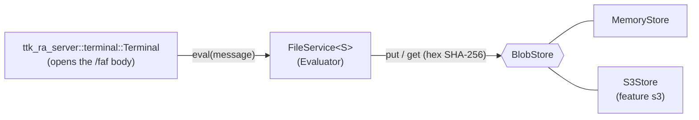
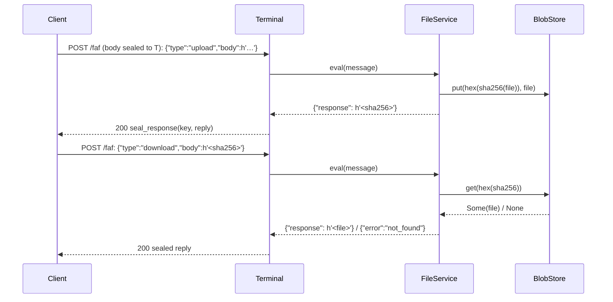
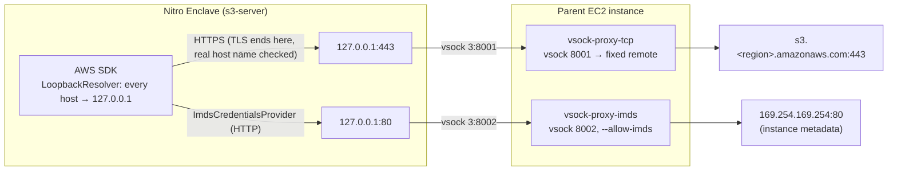

# `ttk-storage` Architecture

Crate reference for `crates/storage`. For the system-level picture, see the [workspace architecture](ARCHITECTURE.md).

Other crates: [`ttk-core`](core.md) · [`ttk-ra-server`](ra-server.md) · [`ttk-ra-client`](ra-client.md) · [`ttk-relay`](relay.md) · [`ttk-root`](root.md) · [`ttk-executables`](executables.md)

> **Role:** what the terminal node does with a message. The terminal itself is [`ttk_ra_server::terminal::Terminal`](ra-server.md#5-terminal-post-faf); this crate supplies its `Evaluator`, the **file service** (`FileService`), and the content-addressed **blob stores** it keeps files in (in memory, or Amazon S3 reached over vsock from inside the enclave). Library only: the `s3-server` and `local-mem-server` binaries live in [`ttk-executables`](executables.md).

## 1. Files

| File | Responsibility |
|---|---|
| `crates/storage/src/lib.rs` | `FileService<S: BlobStore>` (`Evaluator`), `blob_name`, `hex_encode`; re-exports `ttk_ra_server::{Evaluator, EvalError}` and `ttk_core::file_message::{FileRequest, FileResponse, FileError, SHA256_LEN}` |
| `crates/storage/src/adaptors/mod.rs` | `BlobStore` trait |
| `crates/storage/src/adaptors/local_memory.rs` | `MemoryStore`: an in-memory map (tests, `local-mem-server`) |
| `crates/storage/src/adaptors/s3.rs` | `S3Store` (feature `s3`): one S3 bucket, optionally over vsock, optionally with instance-role credentials over vsock |

## 2. File service

Messages and replies are CBOR (RFC 8949) maps whose values are **byte strings**, so a file travels as raw bytes rather than base64. The wire types are `ttk_core::file_message` (shared with the `client` binary).

| Message (CBOR) | Reply (CBOR) |
|---|---|
| `{"type": "upload", "body": h'<file>'}` | `{"response": h'<SHA-256 of the file>'}` |
| `{"type": "download", "body": h'<SHA-256>'}` | `{"response": h'<file>'}` |
| `{"type": "download", "body": h'<unknown SHA-256>'}` | `{"error": "not_found"}` |

The SHA-256 is the raw 32-byte digest; the stored blob's name is its lowercase hex (`blob_name`, which rejects anything but 32 bytes so a download cannot name another object). Storage is content-addressed: uploading the same file twice stores one blob.

A missing file is a reply like any other (`FileResponse::Error(FileError::NotFound)`), **sealed** to the sender: relays see the same `200` for a missing file as for a found one. Only a malformed message or a store failure is an `EvalError`, which the terminal answers with a `500` without detail.

| Item | Description |
|---|---|
| `FileService::new(store)` | Serve files from `store` |
| `FileService::handle(request)` | One `FileRequest` → `FileResponse` |
| `impl Evaluator for FileService<S>` | CBOR decode → `handle` → CBOR encode |
| `BlobStore` | `put(name, data)`, `get(name) -> Option<Vec<u8>>`; `Send + Sync + 'static`, errors are `EvalError` |
| `MemoryStore::new()` | In-memory, nothing persisted |

## 3. `S3Store` (feature `s3`)

`S3Store::from_env()` reads its configuration from the environment, builds the AWS SDK client on rustls with `ring`, and stores each blob as one object of the bucket.

| Variable | Default | Effect |
|---|---|---|
| `TTK_S3_BUCKET` | required | Bucket name (empty = error) |
| `TTK_S3_ENDPOINT` | unset | Endpoint URL override (S3-compatible stores, tests); path-style addressing |
| `AWS_REGION`, `AWS_ACCESS_KEY_ID`, … | — | The standard AWS chain for region and credentials |
| `TTK_S3_VSOCK_PORT` | unset (empty = unset) | Linux: reach S3 over vsock through the parent's `vsock-proxy-tcp` on this port (conventionally `8001`) |
| `TTK_IMDS_VSOCK_PORT` | unset (empty = unset) | Linux: take credentials from the parent's instance role, via the instance metadata service over vsock on this port (conventionally `8002`) |

A Nitro Enclave has no network. With the vsock variables set, `S3Store` starts loopback TCP listeners that carry every connection over vsock to the parent (`ttk_core::vsock::forward_tcp_to_vsock`):

| Aspect | Behaviour |
|---|---|
| Name resolution | `LoopbackResolver` answers `127.0.0.1` for every name, so the SDK connects to the local forwarder; TLS still verifies the real S3 host name |
| TLS | End to end between the enclave and S3: the parent only moves ciphertext |
| Destination | Fixed by the parent (`vsock-proxy-tcp --remote`), never chosen by the enclave; egress policy applied on the parent |
| Credentials | From the instance role through `vsock-proxy-imds`. They pass through the (untrusted) parent, which holds the role anyway: scope the role to the bucket |
| Off Linux | Setting either vsock variable is an error (vsock is Linux only) |

In EIF builds the bucket, the region and both vsock ports are baked into the image (see [deployment](ARCHITECTURE.md#9-deployment)), so they are part of the measurements.

## 4. Features and tests

| Feature | Default | Effect |
|---|:---:|---|
| `nitro`, `mock`, `sev-snp`, `tdx` | `nitro`, `mock` | Forward to `ttk-ra-server` |
| `s3` | — | `adaptors::s3::S3Store` (`aws-config`, `aws-sdk-s3`, `aws-smithy-http-client` with `rustls-ring`, `aws-smithy-runtime-api`) |

| File | Covers |
|---|---|
| `crates/storage/tests/file_service_tests.rs` | `FileService` on a `MemoryStore`: CBOR byte strings, bad requests, missing file = `not_found`; as a terminal's evaluator over `/faf` |
| `crates/storage/tests/terminal_tests.rs` | `Terminal`'s `POST /faf`: sealed evaluator reply, undecryptable body, relays left, locked until the certificate is replaced |
| `crates/storage/tests/s3_tests.rs` | `S3Store` (feature `s3`): configuration errors, vsock needs Linux, put/get/missing/service errors against a minimal local S3 fake, `LoopbackResolver` |
